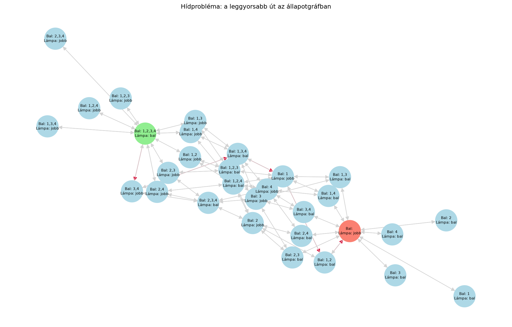

# Hídprobléma – függvénydokumentáció

## Állapotábrázolás

Egy állapot két értékből áll:

```text
(bal_part, lampa_oldala)
```

- `bal_part`: a bal parton lévő túrázók azonosítóinak `frozenset` halmaza;
- `lampa_oldala`: `0`, ha a lámpa a bal parton, illetve `1`, ha a jobb parton
  van.

Egy lépést a `(költség, új_állapot, lépés)` hármas ír le. A lépés egy irányból
(`"->"` vagy `"<-"`) és az átkelő túrázók azonosítóiból áll.

## A `main.py` függvényei

### `get_bank(left, side, everyone)`

Meghatározza, melyik parton van a lámpa, vagyis honnan indulhat a következő
átkelés.

- Ha `side == 0`, a lámpa a bal parton van, ezért `left` értékét adja vissza.
- Egyébként a jobb parton van, ezért az `everyone - left` halmazt adja vissza.

**Paraméterek:**

- `left`: a bal parton lévő túrázók halmaza;
- `side`: a lámpa oldalát jelölő `0` vagy `1`;
- `everyone`: az összes túrázó azonosítóinak halmaza.

**Visszatérési érték:** a lámpát tartalmazó part túrázóinak halmaza.

### `crossing_groups(bank)`

Létrehozza az adott parton tartózkodó összes megengedett átkelő csoportot.
Minden csoport egy vagy két túrázóból áll, ezért egyeseket és párokat
generál. A párok csak egyszer szerepelnek, mert az azonosítók növekvő sorrendjét
használja.

**Paraméter:** `bank`, az adott part túrázóinak halmaza.

**Visszatérési érték:** egyes és páros csoportokat tartalmazó lista.

### `crossing_time(group, times)`

Kiszámítja egy csoport átkelési idejét. Mivel a csoportnak együtt kell átkelnie,
az időt a leglassabb túrázó határozza meg.

**Paraméterek:**

- `group`: az átkelő túrázók azonosítói;
- `times`: szótár, amely az azonosítóhoz tartozó időt tartalmazza.

**Visszatérési érték:** az átkelés ideje percben.

### `apply_move(left, side, group)`

Alkalmazza az átkelést a bal parti állapotra.

- Balról jobbra haladáskor (`side == 0`) eltávolítja a csoportot a `left`
  halmazból.
- Jobbról balra haladáskor hozzáadja a csoportot a `left` halmazhoz.

**Visszatérési érték:** az átkelés után a bal parton lévő túrázók
`frozenset` halmaza.

### `next_states(state, everyone, times)`

Generátorként előállítja egy állapot összes közvetlenül elérhető következő
állapotát. Meghatározza a lámpát tartalmazó partot, létrehozza az összes
lehetséges egy- vagy kétfős csoportot, majd mindegyikhez kiszámítja:

1. az átkelés költségét;
2. az új állapotot;
3. a megjeleníthető lépést.

**Visszatérési érték:** `(cost, new_state, move)` hármasokat előállító
generátor.

### `bridge_problem(number_of_tourists, minutes_to_cross)`

Megkeresi a híd teljes átkelésének minimális idejét. A prioritási sor mindig a
legkisebb eddigi költségű állapotot dolgozza fel, ezért a módszer a Dijkstra-
algoritmus elvét követi. A már feldolgozott állapotokat a `seen` halmazban
tartja nyilván.

Amikor a bal part kiürül, a függvény visszaadja az addig összegyűjtött teljes
időt és a lépések listáját. Ha nincs elérhető megoldás, `(float("inf"), [])`
értéket ad vissza.

**Paraméterek:**

- `number_of_tourists`: a túrázók száma;
- `minutes_to_cross`: a túrázók átkelési ideje azonosító szerinti sorrendben.

**Visszatérési érték:** `(összes_idő, lépések)` tuple.

### `number_of_tourists(nums)`

Ellenőrzi a túrázók számát. Csak az 1 és 10 közötti értékeket fogadja el.

**Visszatérési érték:** az ellenőrzött szám.

**Hiba:** `ValueError`, ha a szám nem esik az engedélyezett tartományba.

### `minutes_to_cross(nums)`

Először ellenőrzi a túrázók számát a `number_of_tourists` függvénnyel, majd
bekéri minden túrázó átkelési idejét. Az időket egész számmá alakítja, és csak
pozitív értékeket fogad el.

**Visszatérési érték:** az átkelési időket tartalmazó lista.

**Hiba:** `ValueError`, ha egy megadott idő nem pozitív.

### `main()`

A parancssoros program belépési pontja. Bekéri a túrázók számát, a hibás
darabszámot újra bekéri, majd bekéri az egyes átkelési időket. Ezután kiírja az
időket és a legrövidebb teljes átkelési időt a `bridge_problem` eredményéből.

## A modulok futtatása

A [`main.py`](E:/uni/uni-discrete-maths-challenges/bridge-problem/main.py)
közvetlen futtatása interaktív adatbekérést indít:

```text
python main.py
```

A [`graph.py`] a dokumentácíot segíti a futtatásához szükséges python libraryk a:
```
matplotlib>=3.7
networkx>=3.0
```
közvetlen futtatásakor a beépített `[1, 2, 5, 10]` példa eredménye jelenik meg,
